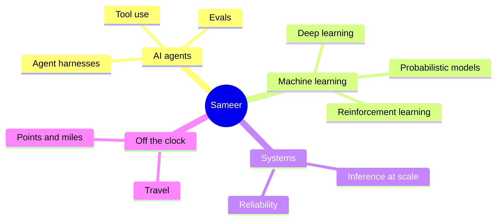

<h1 align="center">Hi, I'm Sameer 👋🏽</h1>

  I build agentic AI tools and like digging into the infrastructure underneath them. 
  Lately I'm going deeper on ML fundamentals: deep learning, RL, and how models get served at scale.

  
  
  

---

### 🧠 What I'm into

### 🛠️ Stack

  
   
  

### 📊 GitHub activity

  <picture>
    <source media="(prefers-color-scheme: dark)" srcset="https://github-readme-stats.vercel.app/api?username=sameer-h&show_icons=true&hide_border=true&include_all_commits=true&theme=github_dark">
    
  </picture>
  <picture>
    <source media="(prefers-color-scheme: dark)" srcset="https://github-readme-stats.vercel.app/api/top-langs/?username=sameer-h&layout=compact&hide_border=true&langs_count=6&theme=github_dark">
    
  </picture>

<picture>
  <source media="(prefers-color-scheme: dark)" srcset="https://streak-stats.demolab.com?user=sameer-h&hide_border=true&theme=github-dark-blue">
  
</picture>

 

<picture>
  <source media="(prefers-color-scheme: dark)" srcset="https://raw.githubusercontent.com/sameer-h/sameer-h/output/github-snake-dark.svg">
  
</picture>
